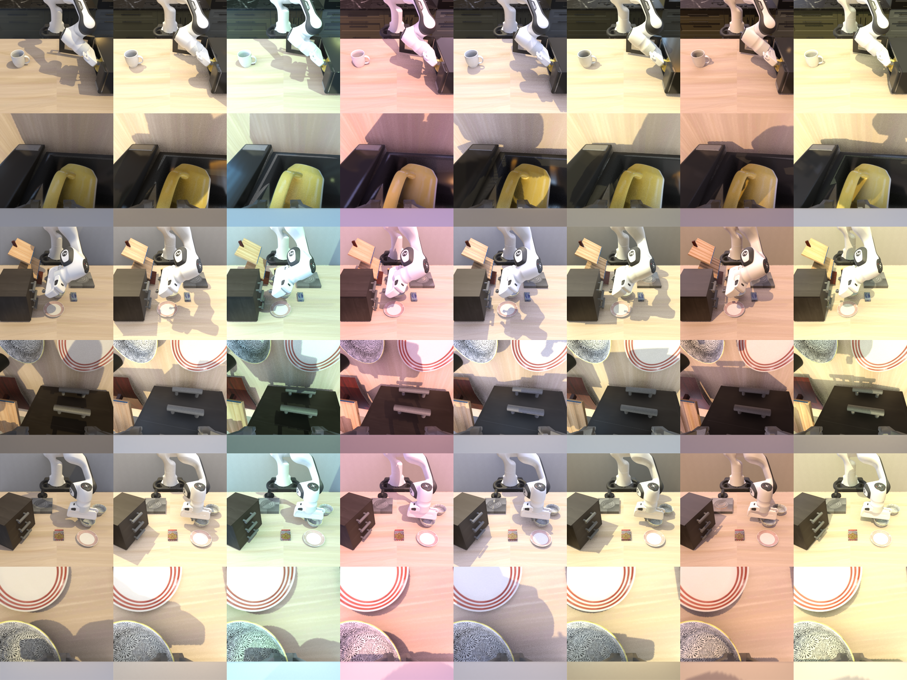

# LIBERO-Blender

[LIBERO](https://github.com/Lifelong-Robot-Learning/LIBERO) with Blender rendering. Physics, init states
and success checks are LIBERO's own, bit for bit; only the camera images (agentview and wrist) come from
Blender. This repo has:

- **A LIBERO env wrapper** that renders observations with Blender (EEVEE or Cycles), with fixed or
  per-episode random lighting.
- **Dataset generation**: re-render LIBERO's demo files with Blender, in LIBERO's own HDF5 format.
  Both renders of all five suites are on Hugging Face: [JiecaoBoy/LIBERO-blender](https://huggingface.co/datasets/JiecaoBoy/LIBERO-blender).
- **Closed-loop evaluation** with MuJoCo or Blender images, fixed or random lighting, for any policy
  that runs as a small server.

| MoDE policy, LIBERO-10 | Fixed lighting | Random lighting |
|---|---|---|
| Trained on MuJoCo images, eval on MuJoCo | 0.960 | – |
| Trained on MuJoCo images, eval on EEVEE / Cycles | 0.000 / 0.000 | – |
| Trained on EEVEE | 0.915 | 0.010 |
| Trained on Cycles | 0.810 | 0.010 |
| Trained on EEVEE, with lighting augmentation | 0.925 | 0.400 |
| Trained on Cycles, with lighting augmentation | 0.900 | 0.650 |

Details in [REPORT.md](REPORT.md).



## Setup

Needs Linux, an NVIDIA GPU and [uv](https://docs.astral.sh/uv/).

```bash
git clone --recurse-submodules https://github.com/YinlongDai/LIBERO-blender.git
cd LIBERO-blender
uv sync                       # Python 3.8 env with LIBERO (third_party/LIBERO), robosuite 1.4.1, MuJoCo 3.2.3
scripts/install_blender.sh    # official Blender 4.4.0 build into .cache/blender (370 MB)
```

Paths are set in `configs/paths.yaml`; usually only `libero_datasets` needs changing:

```yaml
libero_datasets: /data/libero/datasets   # LIBERO's demo files, one folder per suite (only for dataset generation)
rendered_datasets: datasets              # where re-rendered files go
results: results                         # eval results
blender: .cache/blender/blender-4.4.0-linux-x64/blender   # or your own Blender 4.4
```

Run with `MUJOCO_GL=egl` on a machine without a display.

## Blender images in a LIBERO env

```python
from libero_blender.env import BlenderEnv
from libero_blender.scene import make_env

env, task, init_states = make_env("libero_10", task_id=0, image_size=128)
env.set_init_state(init_states[0])
env = BlenderEnv(env, "configs/render/eevee.yaml")                    # fixed lighting
# env = BlenderEnv(env, "configs/render/eevee.yaml", lighting="configs/lighting/random.yaml")

obs = env.reset()                     # with random lighting, every reset draws a new lighting
obs = env.set_init_state(init_states[0])
obs, reward, done, info = env.step(action)   # obs["agentview_image"], obs["robot0_eye_in_hand_image"] from Blender
env.close()
```

`BlenderEnv` starts Blender in the background and passes everything else to the LIBERO env. Images
keep robosuite's raw orientation, so existing preprocessing applies unchanged.

## Settings

| File | What it sets |
|---|---|
| `configs/paths.yaml` | dataset, output and Blender paths |
| `configs/render/eevee.yaml`, `cycles.yaml` | renderer, samples, fixed lighting |
| `configs/lighting/random.yaml` | random lighting ranges: light colour, key light position, fill rotation, brightness |
| `configs/eval.yaml` | eval protocol: suite, trials, seed, replanning |
| `configs/dataset.yaml` | checks run during dataset generation |

## Dataset generation

```bash
python scripts/render_dataset.py --render configs/render/eevee.yaml --suite libero_10 \
    --file KITCHEN_SCENE3_turn_on_the_stove_and_put_the_moka_pot_on_it_demo.hdf5
python scripts/summarize_dataset.py --name eevee
```

Every demo state is replayed in MuJoCo and rendered by Blender. Each file is checked twice: MuJoCo's
re-render must match the stored images, and a Blender geom-id render must match MuJoCo segmentation.
Re-rendering is resumable. `slurm/render_dataset.sbatch` runs all 130 files as a Slurm array.

## Evaluation

```bash
python scripts/evaluate.py --render configs/render/eevee.yaml --task-id 0 --policy-port 6000 --name my_policy
python scripts/evaluate.py --render configs/render/eevee.yaml --lighting configs/lighting/random.yaml ...
python scripts/evaluate.py --render mujoco ...
python scripts/summarize_eval.py results/eval/my_policy --out results/eval/summary.md
```

The policy runs in its own process and Python environment and answers `act` requests. The
observation it receives and the actions it returns are described in `scripts/evaluate.py`;
`scripts/policies/mode_server.py` is an example for semantic_diffusion MoDE checkpoints. With random
lighting, a trial's lighting depends only on (seed, task, trial), so all policies see the same
lightings. `slurm/evaluate.sbatch` runs one task per array task.

## Layout

```
configs/                YAML settings
libero_blender/
  env.py                BlenderEnv wrapper
  renderer.py           starts and talks to the Blender process
  scene.py              LIBERO envs and the scene export Blender builds from
  lighting.py           random lighting samples
  alignment.py          geom-id check against MuJoCo segmentation
  protocol.py           socket messages (render server, policy server)
  blender/              runs inside Blender: scene building, render settings, lighting, server
scripts/                dataset generation, evaluation, summaries, example policy server
slurm/                  example Slurm array jobs
third_party/LIBERO      LIBERO (git submodule)
results/eval/           the eval results in REPORT.md
```

## License

Code: MIT ([LICENSE](LICENSE)). Datasets: CC BY 4.0, like the LIBERO datasets they are rendered from.
Please cite LIBERO if you use them:

```bibtex
@article{liu2023libero,
  title   = {LIBERO: Benchmarking Knowledge Transfer for Lifelong Robot Learning},
  author  = {Liu, Bo and Zhu, Yifeng and Gao, Chongkai and Feng, Yihao and Liu, Qiang and Zhu, Yuke and Stone, Peter},
  journal = {arXiv preprint arXiv:2306.03310},
  year    = {2023}
}
```
